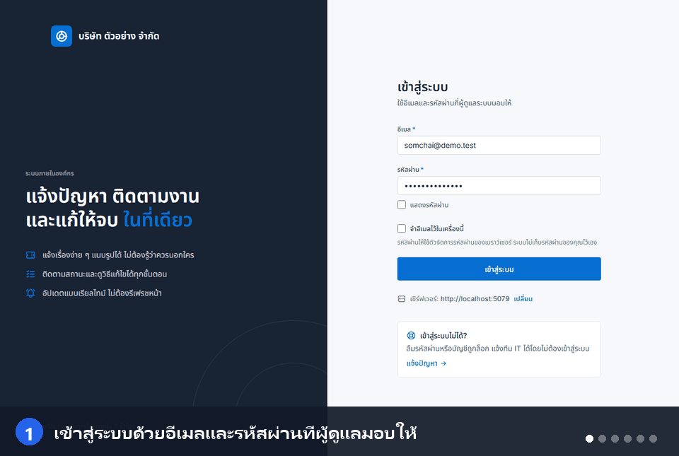
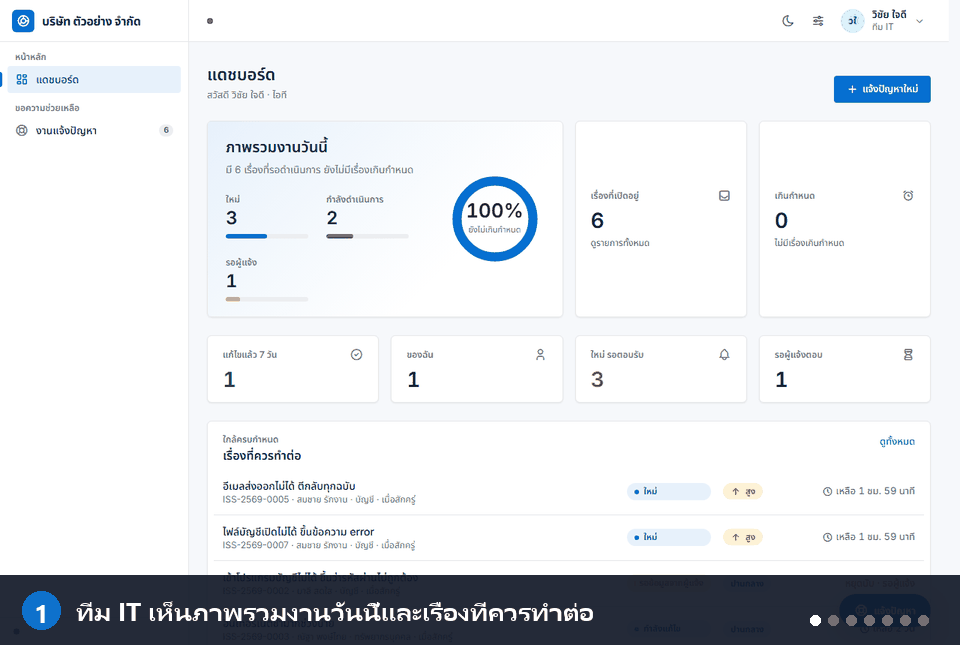

# Helpdesk


ระบบ Helpdesk สำหรับองค์กร ให้พนักงานแจ้งปัญหา (IT, อาคารสถานที่ หรืออะไรก็ได้ที่ต้องมีคนรับเรื่อง) ทีมช่วยเหลือรับเรื่อง
แก้ไข บันทึกวิธีแก้ และติดตามด้วย SLA โดยทุกคนเห็นความคืบหน้าแบบเรียลไทม์ และได้รับอีเมลแจ้งเตือนเป็นภาษาไทย

**ติดตั้งได้ 3 แบบ** ตามขนาดและงบของคุณ: บนเซิร์ฟเวอร์ Windows ภายในบริษัทด้วย SQL Server (ไม่ต้องมี IIS/Docker),
ผ่านแอป Windows (.exe) ที่มีเซิร์ฟเวอร์ในตัว หรือบนคลาวด์ (Render + Vercel + PostgreSQL) ดู [เลือกวิธีติดตั้ง](#เลือกวิธีติดตั้ง)



*ตัวอย่างการแจ้งปัญหา ตั้งแต่เข้าสู่ระบบ ส่งเรื่อง ติดตามสถานะ จนปิดเรื่อง (ข้อมูลในภาพเป็นข้อมูลทดลอง)*

> ระบบนี้เริ่มจากโปรแกรมติดตาม KPI ฟีเจอร์ KPI ถูกถอดออกแล้ว ข้อมูลเดิมในฐานข้อมูลถูกเก็บไว้ในตาราง
> `Archive_Kpis`, `Archive_Projects`, `Archive_KpiProgressLogs` (ไม่ได้ลบ) ชื่อ namespace `KPI.*` ในโค้ดเก็บไว้เหมือนเดิม

## สารบัญ

- [ใช้ทำอะไรได้บ้าง](#ใช้ทำอะไรได้บ้าง)
- [เลือกวิธีติดตั้ง](#เลือกวิธีติดตั้ง)
- [ติดตั้งแบบที่ 1: เซิร์ฟเวอร์ Windows + SQL Server](#ติดตั้งแบบที่-1-เซิร์ฟเวอร์-windows--sql-server)
- [ติดตั้งแบบที่ 2: แอป Windows (.exe)](#ติดตั้งแบบที่-2-แอป-windows-exe)
- [ติดตั้งแบบที่ 3: คลาวด์ (Render + Vercel)](#ติดตั้งแบบที่-3-คลาวด์-render--vercel)
- [ตั้งค่าครั้งแรกหลังติดตั้ง (ผู้ดูแลระบบ)](#ตั้งค่าครั้งแรกหลังติดตั้ง-ผู้ดูแลระบบ)
- [วิธีใช้งาน](#วิธีใช้งาน)
- [ให้ระบบเกิดประโยชน์จริง](#ให้ระบบเกิดประโยชน์จริง)
- [อัปเดต สำรอง และแก้ปัญหา](#อัปเดต-สำรอง-และแก้ปัญหา)
- [สำหรับนักพัฒนา](#สำหรับนักพัฒนา)
- [เอกสารเพิ่มเติม](#เอกสารเพิ่มเติม)

---

## ใช้ทำอะไรได้บ้าง

| คุณเป็น | Helpdesk ช่วยอะไร |
|---|---|
| พนักงานทั่วไป | แจ้งปัญหาพร้อมรูป (วางหรือลากภาพหน้าจอได้) ติดตามสถานะ ตอบกลับ และกดยืนยันเมื่อแก้เสร็จ ไม่ต้องโทรหรือแชตตามเรื่อง |
| ทีมไอที / ทีมช่วยเหลือ | มีคิวงานเดียว รู้ว่าเรื่องไหนเร่ง เรื่องไหนเกินกำหนด มอบหมายงาน บันทึกสาเหตุและวิธีแก้ไว้เป็นความรู้ |
| ผู้จัดการ / ผู้บริหาร | เห็นเรื่องของแผนกตัวเอง (หรือทุกแผนก) ตัวเลขงานค้าง และเรื่องที่เกินกำหนด |
| ผู้ดูแลระบบ | กำหนดผู้ใช้ แผนก สิทธิ์ นโยบายรหัสผ่าน SLA อีเมล และตรวจย้อนหลังได้ว่าใครทำอะไรเมื่อไร |

### ฟีเจอร์

- **แจ้งปัญหา** แนบรูปได้ ระบบเก็บข้อมูลเครื่อง/หน้าที่เกิดปัญหาให้อัตโนมัติ
- **หน้าแจ้งปัญหาสำหรับคนที่เข้าสู่ระบบไม่ได้** (`/report`) ไม่ต้องล็อกอิน มีระบบกันสแปม
- **สถานะงาน** ใหม่ → มอบหมาย → กำลังดำเนินการ → รอผู้แจ้ง → แก้ไขแล้ว → ปิด (หรือไม่ดำเนินการ / เปิดใหม่)
- **SLA** กำหนดเวลาตอบรับและแก้ไขตามความเร่งด่วน หยุดนับตอนรอผู้แจ้ง และเตือนเมื่อเกินกำหนด
- **บันทึกวิธีแก้** สาเหตุ วิธีแก้ วิธีป้องกัน ลิงก์อ้างอิง เวลาที่ใช้
- **คอมเมนต์ภายใน** ทีมช่วยเหลือคุยกันเองโดยผู้แจ้งไม่เห็น
- **อีเมลแจ้งเตือน** เป็นภาษาไทย ผ่าน SMTP ขององค์กร และ **อัปเดตแบบเรียลไทม์ผ่าน SignalR**
- **แดชบอร์ด** งานค้าง เรื่องเกินกำหนด และเรื่องที่ควรทำต่อ
- **RBAC** สิทธิ์ตามบทบาท ตรวจจากฐานข้อมูลทุกคำขอ (ปิดใช้งานผู้ใช้แล้วมีผลทันที)
- **ภาพรวมระบบและ Audit** SuperAdmin ดูความเคลื่อนไหวทั้งระบบ ใครทำอะไร จาก IP ไหน
- **ปรับแต่งหน้าตา** ธีมสว่าง/มืด สีหลัก ฟอนต์ มุมโค้ง เมนู ขนาดตัวอักษร

---

## เลือกวิธีติดตั้ง

| | **แบบที่ 1: เซิร์ฟเวอร์ Windows** | **แบบที่ 2: แอป Windows (.exe)** | **แบบที่ 3: คลาวด์** |
|---|---|---|---|
| เหมาะกับ | ใช้จริงทั้งบริษัท ข้อมูลอยู่ในเครือข่ายภายใน | ลองใช้ หรือทีมเล็กที่ไม่มีเซิร์ฟเวอร์กลาง | ต้องเข้าถึงจากนอกบริษัท ไม่มีเซิร์ฟเวอร์ของตัวเอง |
| ฐานข้อมูล | SQL Server 2017+ (Express ใช้ได้) | SQL Server (ต่อจากแอปเหมือนใน SSMS) | PostgreSQL (เช่น Supabase) |
| ผู้ใช้เข้าด้วย | เบราว์เซอร์ หรือแอป .exe | แอป .exe | เบราว์เซอร์ |
| ต้องมี | Windows Server/10/11 + SQL Server | Windows + SQL Server ที่เข้าถึงได้ | บัญชี Render, Vercel, ฐานข้อมูล PostgreSQL |
| แจ้งเตือนแบบเรียลไทม์ข้ามเครื่อง | ✓ | ✗ (ต้องรีเฟรช) | ✓ |

ถ้าไม่แน่ใจ ให้เลือก **แบบที่ 1** สำหรับใช้งานจริง และ **แบบที่ 2** สำหรับลองดูก่อน

---

## ติดตั้งแบบที่ 1: เซิร์ฟเวอร์ Windows + SQL Server

โปรแกรมเดียวทำทั้งหน้าเว็บและ API รันเป็น Windows Service ไม่ต้องใช้ IIS และไม่ต้องติดตั้ง .NET

**สิ่งที่ต้องมี**

- เครื่อง Windows Server 2016+ (หรือ Windows 10/11) 64 บิต ที่เปิด PowerShell แบบ Run as administrator ได้
- SQL Server 2017+ ที่เปิด TCP/IP แล้ว และบัญชีที่สร้างฐานข้อมูลได้ เช่น `sa` (ใช้ครั้งเดียว ไม่ถูกบันทึก)
- พอร์ตที่ว่าง (ค่าเริ่มต้น 8080)

**ขั้นตอน**

1. โหลด `helpdesk-server-<เวอร์ชัน>.zip` จากหน้า [Releases](https://github.com/Littihai/kpi-management/releases/latest) แล้วแตกไฟล์ เช่น ที่ `C:\Temp\helpdesk-server`
2. เปิด PowerShell แบบ Administrator ไปที่โฟลเดอร์นั้น แล้วรัน

   ```powershell
   Set-ExecutionPolicy -Scope Process Bypass
   .\install.ps1 -PublicUrl http://helpdesk01:8080 -OpenFirewall
   ```

   `-PublicUrl` คือที่อยู่ที่ผู้ใช้จะพิมพ์เปิด Helpdesk (ชื่อเครื่องหรือ IP ตามด้วยพอร์ต) สคริปต์จะติดตั้ง service ชื่อ `Helpdesk`
   ที่ `C:\Helpdesk` เริ่มเองเมื่อเปิดเครื่อง และสร้างคีย์เซ็น token แบบสุ่มให้
3. **บนเครื่องเซิร์ฟเวอร์เอง** เปิดเบราว์เซอร์ไปที่ `http://localhost:8080` จะเห็นหน้าต่าง "เชื่อมต่อฐานข้อมูล" กรอก

   | ช่อง | ตัวอย่าง |
   |---|---|
   | เซิร์ฟเวอร์ SQL | `172.21.10.201,58880` (ชื่อหรือ IP แล้วคั่นพอร์ตด้วย **คอมมา** ไม่ต้องมี `http://`) |
   | ชื่อผู้ใช้ / รหัสผ่าน | `sa` และรหัสผ่านของ `sa` |
   | ชื่อฐานข้อมูล | `helpdesk` (ตั้งใหม่ ถ้ายังไม่มีระบบจะสร้างให้) |
   | ผู้ดูแลระบบคนแรก | อีเมล ชื่อ และรหัสผ่านอย่างน้อย 8 ตัวอักษร |

   กด **สร้างฐานข้อมูลและเริ่มระบบ** ระบบสร้างตาราง และบัญชีเฉพาะสำหรับโปรแกรม (`helpdesk_<ชื่อเครื่อง>`) รหัสผ่าน `sa` ไม่ถูกเก็บ
4. ล็อกอินด้วยผู้ดูแลที่เพิ่งสร้าง แล้วไปต่อที่ [ตั้งค่าครั้งแรกหลังติดตั้ง](#ตั้งค่าครั้งแรกหลังติดตั้ง-ผู้ดูแลระบบ)
5. ให้ผู้ใช้เปิด `http://helpdesk01:8080` ในเบราว์เซอร์ หรือติดตั้งแอป .exe (ดูแบบที่ 2) ให้ IT ตั้งที่อยู่เซิร์ฟเวอร์ให้ทั้งเครื่องได้
   โดยสร้างไฟล์ `C:\ProgramData\Helpdesk\server.txt` ใส่ที่อยู่ในบรรทัดแรก

**ควรรู้**

- ใช้ `http` ได้ในเครือข่ายภายใน แต่รหัสผ่านไม่ถูกเข้ารหัส ถ้าต้องการ HTTPS ให้ใส่ reverse proxy หรือใบรับรองเอง (ดูคู่มือ)
- เพิ่มเครื่องที่ 2, 3 ที่ใช้ฐานข้อมูลเดียวกันได้ ทำขั้น 1–3 ซ้ำบนแต่ละเครื่อง
- ติดตั้งด้วยสคริปต์ล้วน (ไม่ใช้หน้าเว็บ) ได้ด้วย `-WithDatabase` และใช้ Docker ได้ ดูคู่มือฉบับเต็ม

คู่มือละเอียด พร้อมภาพรวมและวิธีแก้อาการที่เจอจริง:
[docs/install-from-scratch-th.md](docs/install-from-scratch-th.md) · [deploy/README-th.md](deploy/README-th.md)

---

## ติดตั้งแบบที่ 2: แอป Windows (.exe)

1. โหลด `Helpdesk-Setup-<เวอร์ชัน>.exe` จากหน้า [Releases](https://github.com/Littihai/kpi-management/releases/latest) แล้วติดตั้ง
   (ติดตั้งเฉพาะผู้ใช้ ไม่ต้องใช้สิทธิ์ admin ตัวติดตั้งยังไม่ได้ลงลายมือชื่อ Windows SmartScreen จะเตือนครั้งแรก
   ให้กด More info → Run anyway)
2. เปิดแอป เลือกทางใดทางหนึ่ง
   - **ใช้เซิร์ฟเวอร์ของบริษัท** (แบบที่ 1) ใส่ที่อยู่เซิร์ฟเวอร์ เช่น `http://helpdesk01:8080`
   - **ไม่มีเซิร์ฟเวอร์กลาง** แอปเริ่มเซิร์ฟเวอร์ในตัวแล้วให้กรอก Server Name / ล็อกอิน / รหัสผ่านของ SQL Server เหมือนต่อใน SSMS
3. แอปตรวจรุ่นใหม่เองจาก GitHub และติดตั้งเมื่อปิดแอป

**ข้อควรรู้ของโหมดเซิร์ฟเวอร์ในตัว:** ทุกคนที่ได้รับรหัสจะถือรหัสฐานข้อมูลตัวเดียวกัน อย่าแจกรหัส `sa` ให้สร้างบัญชี SQL เฉพาะ
ฐานข้อมูล Helpdesk แล้วแจกบัญชีนั้น และแจ้งเตือนแบบเรียลไทม์ข้ามเครื่องจะไม่ทำงาน (ต้องรีเฟรช) ดูรายละเอียดใน
[deploy/README-th.md](deploy/README-th.md#ไม่มีเซิร์ฟเวอร์กลาง-ใช้เซิร์ฟเวอร์ในตัวแอป)

---

## ติดตั้งแบบที่ 3: คลาวด์ (Render + Vercel)

ใช้ PostgreSQL (เช่น Supabase) เป็นฐานข้อมูล

**Backend → Render**

1. เชื่อม GitHub repository, Root Directory: `backend`, Dockerfile Path: `KPI.API/Dockerfile`
2. ตั้ง Health Check Path เป็น `/health`
3. ตั้ง Environment Variables

   | ตัวแปร | ความหมาย |
   |---|---|
   | `ConnectionStrings__DefaultConnection` | สตริงเชื่อมต่อ PostgreSQL |
   | `Jwt__Key` | ค่าสุ่มอย่างน้อย 32 ตัวอักษร (ไม่ตั้ง/สั้นไป/เป็นค่าตัวอย่าง แอปจะไม่สตาร์ท) |
   | `Admin__Email`, `Admin__Password` | สร้าง SuperAdmin คนแรกบนฐานข้อมูลใหม่ (ลบ `Admin__Password` ออกหลังล็อกอินครั้งแรกได้) |
   | `App__BaseUrl` | URL ของ frontend ใช้ทำปุ่ม "เปิดเรื่อง" ในอีเมล |
   | `Cors__Origins__0` | origin เพิ่มเติม เช่น URL ของ Vercel |
   | `LoginThrottle__ClientIpHeader` | ตั้งเป็น `CF-Connecting-IP` บน Render เพื่อจำกัดการเดารหัสผ่านตาม IP จริง (ถ้า header เป็นรายการ เช่น `X-Forwarded-For` จะอ่านตัวสุดท้าย ใช้ได้กับ proxy ชั้นเดียว) |
   | `PublicIssues__MaxPerDay`, `PublicIssues__MaxUploadMbPerDay` | เพดานรวมของฟอร์มแจ้งปัญหาที่ไม่ต้องล็อกอินต่อ 24 ชั่วโมง (ค่าเริ่มต้น 300 เรื่อง / 300 MB, `0` = ปิด) |
   | `Audit__AnonymousPerAddressPerMinute`, `Audit__AnonymousPerMinute` | จำนวนแถว request log ต่อนาทีของคำขอที่ไม่ล็อกอิน (ค่าเริ่มต้น 20 ต่อ IP / 300 รวม) |

   สร้างค่าสุ่มสำหรับ `Jwt__Key` ด้วย PowerShell:
   `[Convert]::ToBase64String([Security.Cryptography.RandomNumberGenerator]::GetBytes(48))`

**Frontend → Vercel:** Import repository, Root Directory: `frontend`, Framework: Vite และตั้ง `VITE_API_URL=https://<api-ของคุณ>.onrender.com`

อีเมลตั้งในแอปหลังติดตั้ง (ตั้งค่า → อีเมล) ไม่ต้องใช้บริการภายนอกหรือคีย์ที่เซิร์ฟเวอร์

---

## ตั้งค่าครั้งแรกหลังติดตั้ง (ผู้ดูแลระบบ)

ล็อกอินด้วยผู้ดูแลคนแรก แล้วทำตามลำดับนี้ (เมนู **ตั้งค่า**) ใช้เวลาประมาณ 15 นาที

1. **ตั้งค่าระบบ → องค์กร** ใส่ชื่อบริษัท (แสดงบนหน้าเข้าสู่ระบบและในอีเมล)
2. **แผนก** สร้างแผนกที่ใช้จริง ผู้แจ้งเลือกแผนกตอนแจ้งเรื่อง และผู้จัดการเห็นเรื่องของแผนกตัวเอง
3. **ผู้ใช้งาน** เพิ่มคนและกำหนดบทบาท (ดูตารางด้านล่าง) ควรมี ITSupport อย่างน้อย 1–2 คนที่รับคิวงาน การสมัครเองถูกปิด
4. **ตั้งค่าระบบ → SLA** กำหนดเวลาตอบรับและเวลาแก้ไขตามความเร่งด่วน ให้ตรงกับที่ทีมทำได้จริง
5. **อีเมล (SMTP)** ใส่เซิร์ฟเวอร์ พอร์ต (587 + STARTTLS โดยทั่วไป) ผู้ใช้ รหัสผ่าน และ **ที่อยู่ผู้ส่ง** กดบันทึก แล้วกด **ส่งอีเมลทดสอบ**
6. **ความปลอดภัย** ปรับนโยบายรหัสผ่านและการล็อกบัญชีตามที่บริษัทกำหนด
7. ทดสอบเอง แจ้งเรื่องด้วยบัญชี Staff แล้วรับเรื่องด้วยบัญชี ITSupport ให้ครบวงจรก่อนประกาศใช้

### บทบาท

| บทบาท | ทำอะไรได้ |
|---|---|
| SuperAdmin | ทุกอย่าง รวมผู้ใช้ สิทธิ์ ภาพรวมระบบ และ Audit |
| ITSupport | รับเรื่อง มอบหมาย แก้ไข บันทึกวิธีแก้ ของทุกแผนก |
| Director | ดูเรื่องและผู้ใช้ของทุกแผนก |
| Manager | ดูเรื่องของแผนกตัวเอง |
| TeamLeader / Staff / Viewer | แจ้งปัญหาและติดตามเรื่องของตัวเอง |

ปรับสิทธิ์ของแต่ละบทบาทได้ที่ ตั้งค่า → บทบาทและสิทธิ์ ตารางสิทธิ์ละเอียดอยู่ใน [docs/access-and-workflow.md](docs/access-and-workflow.md)

---

## วิธีใช้งาน

### สำหรับผู้แจ้งปัญหา


1. ล็อกอิน แล้วกด **แจ้งปัญหาใหม่** เลือกแผนก ใส่หัวข้อและรายละเอียด (บอกว่าเกิดอะไร ที่ไหน เมื่อไร และเกิดซ้ำหรือไม่)
2. แนบรูป วางภาพหน้าจอ (Ctrl+V) หรือลากไฟล์มาวางได้ (ค่าเริ่มต้นแนบได้ 5 รูป รูปละไม่เกิน 5 MB ผู้ดูแลปรับได้)
3. ติดตามสถานะที่หน้ารายการ จะได้อีเมลและแจ้งเตือนในแอปเมื่อมีความเคลื่อนไหว
4. ถ้าสถานะเป็น **รอผู้แจ้ง** ทีมช่วยเหลือรอข้อมูลจากคุณ ตอบในเรื่องนั้นเพื่อให้งานเดินต่อ
5. เมื่อเป็น **แก้ไขแล้ว** ให้ยืนยันปิดเรื่อง หรือกด **เปิดใหม่** ถ้ายังไม่หาย ถ้าไม่ตอบ ระบบปิดให้เองเมื่อครบกำหนด (ค่าเริ่มต้น 3 วัน)

เข้าสู่ระบบไม่ได้? ใช้หน้า `/report` แจ้งโดยไม่ต้องล็อกอินได้

### สำหรับทีมช่วยเหลือ (ITSupport)



*ภาพนี้ครอบคลุมทั้งมุมมองของทีมไอทีและของผู้ดูแลระบบ (ภาพรวมระบบ ตั้งค่า SLA อีเมล และผู้ใช้งาน)*

1. ดูคิวงานที่หน้ารายการ กรองตามสถานะ ความเร่งด่วน หรือผู้รับผิดชอบ เรื่องที่ใกล้หรือเกินกำหนด SLA จะเห็นได้ชัด
2. **มอบหมาย** ให้ตัวเองหรือเพื่อนร่วมทีม ปรับ **ความเร่งด่วน** ถ้าผู้แจ้งตั้งไม่ตรง แล้วเริ่มดำเนินการ (สถานะกำลังดำเนินการ)
3. ต้องถามเพิ่ม ใช้ **ขอข้อมูลเพิ่ม** สถานะเป็นรอผู้แจ้งและนาฬิกา SLA หยุดนับ
4. คุยกันเองในทีมด้วย **คอมเมนต์ภายใน** ผู้แจ้งไม่เห็น
5. แก้เสร็จ กด **แก้ไขแล้ว** พร้อมบันทึก **สาเหตุ วิธีแก้ วิธีป้องกัน** และเวลาที่ใช้ นี่คือข้อมูลที่ทำให้เรื่องซ้ำแก้ได้เร็วขึ้น
6. เรื่องที่ไม่ต้องทำ (ซ้ำ ไม่ใช่ปัญหาของเรา) ใช้ **ไม่ดำเนินการ** พร้อมเหตุผล

### ไอคอนสถานะและการแจ้งเตือน

จุดสถานะที่แถบด้านบน (และที่ชื่อแท็บของเบราว์เซอร์ ที่ไอคอนถาดระบบ และที่ไอคอนบน Taskbar ของแอป Windows) บอกว่ามีงานรอคุณหรือไม่

| สี | ความหมาย |
|---|---|
| เขียว ✓ | ไม่มีงานรอคุณ |
| แดงพร้อมตัวเลข | มีงานรอคุณ (ทีมไอที: เรื่องใหม่ที่ยังไม่มีผู้รับ, งานที่มอบให้ฉัน, เรื่องเกินกำหนด / ผู้แจ้ง: ทีมไอทีขอข้อมูลเพิ่ม, แก้แล้วรอยืนยัน) |
| เหลือง | กำลังเชื่อมต่อหรือเชื่อมต่อใหม่ |
| เทา | ไม่ได้เชื่อมต่อกับเซิร์ฟเวอร์ |

- **แอป Windows (.exe):** มีการแจ้งเตือนของ Windows เมื่อมีเรื่องที่เกี่ยวกับคุณ ขณะที่หน้าต่างไม่ได้อยู่ด้านหน้า กดที่การแจ้งเตือนเพื่อเปิดเรื่องนั้น ปิดหน้าต่างแล้วแอปยังทำงานที่ถาดระบบ (ปิดได้ที่ ตั้งค่า → ทั่วไป) และตั้งให้เปิดพร้อม Windows ได้
- **เว็บเบราว์เซอร์:** เปิดที่ ตั้งค่า → ทั่วไป → การแจ้งเตือน (เบราว์เซอร์จะขออนุญาตก่อน)
- **ถ้าอีเมลส่งไม่ได้:** ผู้ดูแลระบบกด "ตรวจการเชื่อมต่อ" ที่ ตั้งค่า → อีเมล (SMTP) ระบบจะบอกว่าติดที่ขั้นไหน (ชื่อเซิร์ฟเวอร์ พอร์ตถูกบล็อก การเข้ารหัส ใบรับรอง) พร้อมวิธีแก้ โดยไม่ล็อกอินและไม่ส่งอีเมลจริง

### สำหรับผู้จัดการและผู้บริหาร

- **Manager** เห็นเรื่องของแผนกตัวเอง ส่วน **Director** เห็นทุกแผนก ใช้แดชบอร์ดดูงานค้างและเรื่องเกินกำหนด
- ทั้งสองบทบาทตอบและยืนยันเรื่องของตัวเองได้ แต่ไม่ได้ทำงานในคิว

### สำหรับผู้ดูแลระบบ

- **ผู้ใช้งาน** เพิ่ม ปิดใช้งาน ปลดล็อก ตั้งรหัสผ่านใหม่ (ปิดใช้งานแล้วมีผลทันที ไม่ต้องรอ token หมดอายุ)
- **บันทึกการใช้งาน / ภาพรวมระบบ** ตรวจย้อนหลังว่าใครทำอะไร จาก IP ไหน
- **ฐานข้อมูล** ตรวจว่าขาดตารางหรือคอลัมน์อะไร และกดซ่อม (เพิ่มอย่างเดียว ไม่ลบข้อมูลเดิม)
- **ทั่วไป** ปรับธีม สี ฟอนต์ ของตัวเอง (เก็บในเครื่องนั้น)

### เส้นทางของงาน

```
New → Assigned → InProgress ⇄ WaitingForReporter → Resolved → Closed
              ↘ Rejected (ไม่ดำเนินการ / ซ้ำ)        ↘ Reopened
```

---

## ให้ระบบเกิดประโยชน์จริง

ระบบจะมีประโยชน์เมื่อคนใช้ทุกเรื่อง ไม่ใช่แค่บางเรื่อง คำแนะนำ

- **ใช้ช่องทางเดียว** ประกาศว่าเรื่องที่ไม่อยู่ใน Helpdesk จะไม่ถูกจัดลำดับ ถ้าเรื่องมาทางแชตหรือโทรศัพท์ ให้ทีมช่วยลงเรื่องแทนผู้แจ้ง
- **ตั้ง SLA ที่ทำได้จริง** ตั้งสั้นเกินไปจนเกินกำหนดทุกเรื่อง ทีมจะเลิกสนใจตัวเตือน เริ่มหลวมแล้วค่อยตึงขึ้นตามข้อมูลจริง
- **บันทึกวิธีแก้ทุกครั้ง** เรื่องที่ซ้ำบ่อยสะท้อนปัญหาที่ต้นเหตุ ใช้ข้อมูลนี้ขอแก้ถาวรแทนการแก้ซ้ำทุกสัปดาห์
- **เปิดอีเมลแจ้งเตือน** ผู้แจ้งไม่ต้องเปิดระบบเพื่อดูความคืบหน้า ทดสอบส่งทุกครั้งที่เปลี่ยนค่า SMTP
- **จำกัดสิทธิ์ให้พอดี** ให้บทบาท ITSupport เฉพาะคนที่รับคิวจริง ตรวจ Audit เป็นระยะ
- **ทบทวนทุกเดือน** เปิดแดชบอร์ดดูเรื่องค้างนาน เรื่องเกินกำหนด และปัญหาที่ซ้ำ แล้วปรับ SLA หรือกระบวนการตามนั้น
- **สำรองฐานข้อมูล** เป็นประจำ รูปแนบเก็บอยู่ในฐานข้อมูล จึงอยู่ในไฟล์สำรองเดียวกัน

---

## อัปเดต สำรอง และแก้ปัญหา

**อัปเดต (แบบที่ 1)** สำรองฐานข้อมูลก่อนเสมอ แล้วแตกชุดติดตั้งรุ่นใหม่ และรันใน PowerShell (Administrator)

```powershell
.\install.ps1 -Upgrade
```

สคริปต์เก็บโปรแกรมเดิมไว้ที่ `C:\Helpdesk\api.backup-<เวลา>` และไม่แตะค่าการเชื่อมต่อฐานข้อมูล โครงสร้างฐานข้อมูลปรับให้เองตอนสตาร์ท

**สำรอง** สำรองฐานข้อมูล Helpdesk ตามปกติของ SQL Server และสำรอง `C:\Helpdesk\api\appsettings.Production.json` กับโฟลเดอร์
`C:\Helpdesk\data` (มีคีย์เซ็น token ถ้าหายต้องให้ทุกคนล็อกอินใหม่ และต้องกรอกรหัสผ่าน SMTP ใหม่)

**ถอนการติดตั้ง** `Stop-Service Helpdesk; sc.exe delete Helpdesk; Remove-Item C:\Helpdesk -Recurse` (ฐานข้อมูลไม่ถูกลบ)

| อาการ | ตรวจ |
|---|---|
| เปิดหน้าเว็บแล้วขึ้น "ระบบยังไม่ได้เชื่อมต่อฐานข้อมูล" | เปิด `http://localhost:<พอร์ต>` บนเครื่องเซิร์ฟเวอร์เองเพื่อเชื่อมต่อ (จากเครื่องอื่นทำไม่ได้) |
| เชื่อมต่อ SQL Server ไม่ได้ | บนเครื่องเซิร์ฟเวอร์ Helpdesk รัน `Test-NetConnection <ip> -Port <พอร์ต>` ต้องได้ `TcpTestSucceeded: True` ตรวจ firewall และการเปิด TCP/IP |
| ล็อกอินแล้วขึ้นว่าเชื่อมต่อไม่ได้ | `-PublicUrl` ต้องตรงกับที่อยู่ที่ผู้ใช้พิมพ์จริง (รวม http/https และพอร์ต) |
| service เริ่มแล้วไม่ตอบ | Event Viewer → Windows Logs → Application (source `Helpdesk`) |
| อีเมลไม่ออก | ตั้งค่า → อีเมล (SMTP) → ส่งอีเมลทดสอบ ดูข้อความจากเมลเซิร์ฟเวอร์ และตรวจว่าไม่ได้ปิด `Email__Enabled` |
| ล็อกอินผิดหลายครั้งแล้วถูกบล็อก | รอครบ 15 นาที หรือให้ผู้ดูแลปลดล็อกบัญชี |

ตัวตรวจสุขภาพระบบ: `GET /health` (ทำงานอยู่) และ `GET /health/ready` (ตรวจฐานข้อมูลด้วย)

---

## สำหรับนักพัฒนา

**ต้องมี:** .NET SDK 10, Node.js 20+, ฐานข้อมูล PostgreSQL 15+ หรือ SQL Server 2017+

```bash
# Backend
cd backend
dotnet restore
# สร้าง KPI.API/appsettings.Development.json (ไม่ถูก track ใน git) โดยคัดลอกจาก appsettings.Example.json
# ใส่ ConnectionStrings:DefaultConnection, Jwt:Key (สุ่ม 32+ ตัวอักษร) และ Admin:Email / Admin:Password
cd KPI.API
dotnet run            # http://localhost:5079 ปรับโครงสร้างฐานข้อมูลและสร้าง SuperAdmin คนแรกให้อัตโนมัติ
```

```bash
# Frontend
cd frontend
npm install
echo VITE_API_URL=http://localhost:5079 > .env.local
npm run dev           # http://localhost:5173
```

```bash
# ทดสอบ
cd backend && dotnet test
cd frontend && npx tsc --noEmit && npm run lint
```

- ถ้าไม่ตั้งค่าฐานข้อมูล backend จะเริ่มใน **โหมด setup** รอให้ผู้ดูแลเชื่อมต่อผ่านหน้าเว็บ โปรเจกต์ไม่มีฐานข้อมูลหรือเซิร์ฟเวอร์ตั้งต้นของใคร
- เลือกฐานข้อมูลด้วย `Database__Provider` (`PostgreSql` ค่าเริ่มต้น หรือ `SqlServer`)
- ปิด migrate อัตโนมัติด้วย `Database__AutoMigrate=false` แล้วรัน
  `dotnet ef database update --project KPI.Infrastructure --startup-project KPI.API` เอง
- แอป Windows: `cd desktop && npm install && npm run dist` (ดู [desktop/README.md](desktop/README.md)) ออกรุ่นใหม่โดยสร้าง tag `vX.Y.Z`
- Hangfire Dashboard: `http://localhost:5079/hangfire` (งานดูแลประจำวัน: ปิดเรื่องที่แก้แล้วและไม่มีใครตอบ ล้าง log เก่า)

### สถาปัตยกรรม

```
kpi-management/
├── backend/
│   ├── KPI.Domain/           # Entities, Enums, state machine, ค่าตั้งต้นของ Settings
│   ├── KPI.Application/      # DTOs, Service Interfaces
│   ├── KPI.Infrastructure/   # EF Core, Repositories, Services, Jobs, SMTP
│   ├── KPI.API/              # Controllers, Middleware, Program.cs, โหมด setup
│   └── KPI.Tests/            # xUnit
├── frontend/                 # React + Vite + Tailwind + Zustand
├── desktop/                  # Electron (แอป Windows .exe)
├── deploy/                   # ชุดติดตั้งเซิร์ฟเวอร์ Windows (install.ps1)
└── docs/                     # คู่มือและกติกาสิทธิ์/workflow
```

**Stack:** .NET 10 · EF Core · Hangfire · SignalR · MailKit · QuestPDF · ClosedXML · React 18 · TypeScript · Tailwind 4 · Vite · Zustand · Recharts · Electron

### API โดยย่อ

```
POST /api/auth/login                    # เข้าสู่ระบบ
GET  /api/auth/me                       # ข้อมูลผู้ใช้ + permissions
GET  /api/issues                        # รายการ (กรอง ค้นหา เรียง แบ่งหน้า) ตามสิทธิ์
GET  /api/issues/summary                # ตัวเลขสรุป
POST /api/issues                        # แจ้งปัญหา (multipart + รูป)
POST /api/issues/{id}/comments          # ตอบกลับ / โน้ตภายใน
POST /api/issues/{id}/assign|start|request-info|resolve|confirm|reopen|reject
GET  /api/public/departments            # ไม่ต้องล็อกอิน
POST /api/public/issues                 # แจ้งโดยไม่ต้องล็อกอิน
GET  /api/audit                         # Audit log (SuperAdmin)
/hubs/kpi                               # SignalR (IssueChanged / Notification)
```

รายละเอียดสิทธิ์ สถานะที่เปลี่ยนได้ และรหัสข้อผิดพลาด: [docs/access-and-workflow.md](docs/access-and-workflow.md)

---

## เอกสารเพิ่มเติม

| เอกสาร | เนื้อหา |
|---|---|
| [docs/install-from-scratch-th.md](docs/install-from-scratch-th.md) | ติดตั้งตั้งแต่เริ่มต้นทีละขั้น (Windows Server + SQL Server) |
| [deploy/README-th.md](deploy/README-th.md) | คู่มือ IT ฉบับเต็ม: HTTPS, อัปเดต, สำรอง, แก้ปัญหา, Docker |
| [docs/access-and-workflow.md](docs/access-and-workflow.md) | สิทธิ์ของแต่ละบทบาท, workflow ของเรื่อง, อีเมล, การป้องกันการเดารหัสผ่าน |
| [desktop/README.md](desktop/README.md) | แอป Windows: build, ออกรุ่น, ตั้งเซิร์ฟเวอร์ |

## License

MIT License — ใช้และแก้ไขได้อย่างอิสระ ดูข้อความเต็มที่ [LICENSE](LICENSE) (Copyright (c) 2026 Lttichai Yorach)
